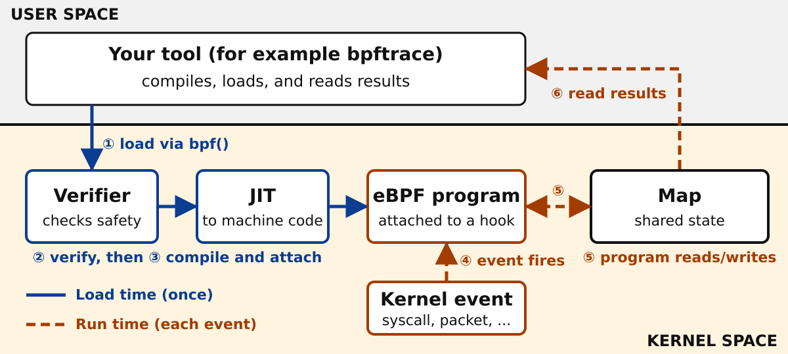

<!-- _class: lead -->
<!-- _paginate: false -->
<!-- _footer: "" -->

# eBPF:<br>Programming the Linux Kernel

## Safely running small programs inside Linux

Linux Day · [Speaker name]

<!--
Timing: 0:00-0:30 (0.5 min). Total talk 25 min plus 5 min questions.
Welcome the audience. Say the goal: by the end, everyone knows what eBPF is, how it works at a high level, and has seen it solve one small problem live.
No prior eBPF knowledge is assumed. Terms are explained before they are used.
Replace [Speaker name] before presenting.
References for the whole talk are listed on slide 14.
-->

---

# A controlled example: the app that never starts

- The app prints **"Starting…"**
- Then nothing. No error. No crash.
- It is not obviously busy, and the logs say nothing.

**What is it waiting for?**

<span class="note">This is a controlled example built for this talk, not a real incident.</span>

<!--
Timing: 0:30-2:00 (1.5 min).
Say clearly that this is a controlled example I prepared for the demo. Do not present it as a real production incident.
Ask the room: how would you find out what a silent program is doing? Expect: read the code, add logging, use a debugger, strace.
Point out the trade-off: each needs a code change, a restart, or a tool attached to just one process. Today we ask the kernel instead, because every file a program opens goes through the kernel.
Transition: to understand "ask the kernel", we need to know what the kernel is.
-->

---

# Two worlds: user space and kernel space

- **Kernel space:** the core of Linux. It controls hardware, memory, files, and networking.
- **User space:** your applications.
- Apps ask the kernel for help through **system calls**.

<div class="zone user"><b>USER SPACE</b> · your app</div>
<div class="syscall">↓ system call: "open this file" · ↑ result</div>
<div class="zone kernel"><b>KERNEL SPACE</b> · files, memory, network, CPU</div>

<!--
Timing: 2:00-3:00 (1 min).
Define: kernel = the privileged core of the operating system; user space = everything else, including your apps and shells.
A system call is the doorway between them. Example used in the demo: openat, the system call used to open a file.
Key idea: because everything passes through the kernel, the kernel is a great place to observe what programs do. The problem was that changing the kernel used to be hard.
Reference: Linux man-pages, syscalls(2) and openat(2): https://man7.org/linux/man-pages/man2/openat.2.html
-->

---

# What is eBPF?

**Small programs that run inside the Linux kernel, when events happen.**

- Early 1990s: BPF, the *Berkeley Packet Filter*, filters network packets for tools like `tcpdump`
- Linux 3.18 (2014): *extended* BPF and the `bpf()` system call
- Today: tracing, networking, and security

<span class="note">Loaded at runtime: no kernel rebuild and no reboot. "eBPF" is now a standalone name.</span>

<!--
Timing: 3:00-5:00 (2 min).
Origins: BPF began as a fast way to filter packets inside the kernel instead of copying every packet to user space (McCanne and Jacobson, "The BSD Packet Filter", USENIX 1993).
Linux later extended it. The bpf() system call arrived in Linux 3.18 (bpf(2) man page). Extended BPF is a general in-kernel mechanism, not only for packets.
Naming: ebpf.io says eBPF is a standalone term that does not stand for anything; the original BPF is sometimes called cBPF (classic BPF).
Be accurate about the claim: eBPF programs can be loaded at runtime without changing kernel source or loading a kernel module. That does not mean it can do anything in the kernel; limits come on later slides.
References:
- https://ebpf.io/what-is-ebpf/
- https://www.tcpdump.org/papers/bpf-usenix93.pdf
- https://man7.org/linux/man-pages/man2/bpf.2.html
- https://docs.kernel.org/bpf/classic_vs_extended.html
-->

---

# Load once, run on every event



<!--
Timing: 5:00-7:30 (2.5 min). This is the key diagram. Walk it slowly in two phases.
Blue, solid arrows are LOAD TIME and happen once:
1. A user-space tool (for example bpftrace) sends the program to the kernel using the bpf() system call.
2. The verifier checks it. If it fails, it never runs.
3. On supported architectures the JIT compiler turns it into machine code, and the program is attached to a hook.
Orange, dashed arrows are RUN TIME and repeat for each event:
4. An event happens at the hook (a system call, a packet, a function entry). The kernel runs the program.
5. The program reads and writes a map.
6. The user-space tool reads the results from the map.
Say: loading is not running. A loaded program waits until its event happens. Hooks are the places the kernel offers: tracepoints, kprobes, network hooks, and others.
Say: the program can only call a fixed set of kernel helper functions, not arbitrary kernel code.
References:
- https://ebpf.io/what-is-ebpf/
- https://man7.org/linux/man-pages/man2/bpf.2.html
- https://man7.org/linux/man-pages/man7/bpf-helpers.7.html
- https://docs.kernel.org/trace/tracepoints.html
-->

---

# Before it runs: verifier and JIT

<div class="cols">
<div class="box">

## Verifier

Checks the program **before** it is attached:

- Memory access is safe
- It always finishes
- Only allowed helpers

</div>
<div class="box">

## JIT compiler

*Just-in-time*: translates portable bytecode to machine code, where the architecture supports it.

</div>
</div>

**Rejected programs never run.**

<span class="note">Passing the verifier does not prove the logic is correct.</span>

<!--
Timing: 7:30-9:00 (1.5 min).
Do not discuss instruction sets or verifier internals.
Verifier: a static analysis in the kernel. Per the bpf(2) man page, it determines that the program terminates and is safe to execute. ebpf.io lists examples: the loader has the required privileges, the program does not crash or harm the system, and it always runs to completion.
Be careful: the verifier reduces risk. It does not guarantee the absence of all bugs. A program can be logically wrong, and the kernel itself, including the verifier, can have bugs.
JIT: bytecode is translated to native machine code on supported architectures; otherwise an interpreter may be used. ebpf.io says JIT lets programs run as efficiently as natively compiled kernel code. Phrase it as "efficiently", not as "free".
References:
- https://docs.kernel.org/bpf/verifier.html
- https://man7.org/linux/man-pages/man2/bpf.2.html
- https://docs.kernel.org/bpf/classic_vs_extended.html
- https://ebpf.io/what-is-ebpf/
-->

---

# Maps: memory and a mailbox

- A program runs **once per event** and then ends.
- A **map** is key-value storage in the kernel.
- It keeps state between events.
- User space can read it: counters, histograms, event data.

**In the demo:** a map remembers which filename a thread asked for.

<!--
Timing: 9:00-10:00 (1 min).
Analogy: the program is a short function that starts fresh each time; the map is a notebook it can write in and that user space can read.
Maps are shared: the same map can be accessed by several eBPF programs and by user-space programs through the bpf() system call (bpf(2); ebpf.io).
Demo link: at syscall entry we know the filename but not the result; at syscall exit we know the result but not the filename. The map carries the filename between the two, keyed by thread ID (tid).
Mention other map types exist (hash, array, ring buffer, and more) without going into detail.
References:
- https://docs.kernel.org/bpf/maps.html
- https://ebpf.io/what-is-ebpf/
- https://man7.org/linux/man-pages/man2/bpf.2.html
Transition: now we use all of this. Switch to the terminals. The slide that follows is a cue card for the demo.
-->

---

# Live demo: find the missing file

```c
tracepoint:syscalls:sys_enter_openat /pid == $1/
{ @path[tid] = str(args.filename); }

tracepoint:syscalls:sys_exit_openat /pid == $1/
{
  if (args.ret == -2) {          // -2 = ENOENT: no such file
    printf("%s ENOENT %s\n", comm, @path[tid]);
  }
  delete(@path, tid);
}
```

**Entry:** remember the name. **Exit:** if it failed, print it.

<span class="note">Simplified. Full file: demo/missing-files.bt. Scope: traces `openat` only.</span>

<!--
Timing: 10:00-15:00 (5 min). Full script is in docs/speaker-guide.md and exact commands are in demo/README.md.
Spend about 1 minute on this slide, then switch to two terminals for about 4 minutes of live work.
Explain: bpftrace is a tool that compiles a small script into eBPF, loads it, and prints results. Two probes attach to two tracepoints, which are stable hook points in the kernel for system call entry and exit. $1 is the PID given on the command line. The slide is a simplified version of the real file; the real file also has a usage check and cleanup.
Scope: this example traces the openat system call only. It does not cover every file-opening API.
Fallback: if the live demo fails, use the fallback in docs/speaker-guide.md and the backup slide at the end. The backup output is illustrative, not captured.
References:
- https://github.com/bpftrace/bpftrace/blob/master/docs/language.md
- https://docs.kernel.org/trace/tracepoints.html
- https://man7.org/linux/man-pages/man2/openat.2.html
-->

---

<!-- _class: big -->

# Observability: see what the system does

- Trace system calls and kernel functions
- Measure latency as histograms
- Profile where CPU time goes
- Count and summarize **inside the kernel**, then send only results to user space

<span class="note">Examples: bpftrace, BCC tools, Pixie, Parca</span>

<!--
Timing: 15:00-16:30 (1.5 min).
Back from the demo: what we did generalizes. Same pattern: hook, program, map, user-space reader.
In-kernel aggregation: instead of sending every event to user space, a program can update a counter or histogram in a map and user space reads only the summary. That can reduce the amount of data moved to user space, but it is not free. Do not claim a specific speedup.
Projects named are examples from the eBPF ecosystem; see the landscape at https://ebpf.io/applications/
Reference: https://ebpf.io/what-is-ebpf/
-->

---

<!-- _class: big -->

# Networking: act on packets early

- **XDP** runs a program when a packet arrives at the network driver
- The program returns a verdict: **pass, drop, or redirect**
- Used for load balancing, filtering, and Kubernetes networking

<span class="note">Examples: Cilium, Katran. Support depends on drivers and kernel version.</span>

<!--
Timing: 16:30-18:00 (1.5 min).
Packet filtering is where BPF started, so this closes the loop with slide 4.
XDP (eXpress Data Path) hooks very early in the receive path. Verdicts include XDP_PASS, XDP_DROP, XDP_TX and XDP_REDIRECT. Native XDP needs driver support; there is also a generic mode with fewer benefits.
Cilium uses eBPF for Kubernetes networking and Katran is a layer-4 load balancer; both are listed in the eBPF landscape.
Here the program changes what happens to a packet, but only through the verdicts the hook defines.
References:
- https://ebpf.io/applications/
- https://docs.kernel.org/networking/af_xdp.html (related XDP documentation)
- https://ebpf.io/what-is-ebpf/
-->

---

<!-- _class: big -->

# Security: watch and, in some cases, enforce

- **Watch:** process starts, file access, network connections
- **Enforce:** hooks designed for decisions, such as BPF LSM
- `seccomp` also uses BPF filters to restrict system calls

<span class="note">Examples: Falco, Tetragon. Policy mistakes can block legitimate work.</span>

<!--
Timing: 18:00-19:00 (1 min).
Runtime security tools watch events such as program execution and file or network activity, then alert or apply policy.
BPF LSM: Linux Security Modules hooks that eBPF programs can attach to, for audit and for access-control decisions (kernel docs, "LSM BPF Programs"). It needs a kernel built with CONFIG_BPF_LSM and enabled in the lsm boot list.
seccomp: the seccomp(2) man page describes filters written as BPF programs (classic BPF) that restrict which system calls a process may make.
Caution: enforcement is only where a hook allows it. Bad policy can break good software, so test carefully.
References:
- https://docs.kernel.org/bpf/prog_lsm.html
- https://man7.org/linux/man-pages/man2/seccomp.2.html
- https://ebpf.io/applications/
-->

---

# Observe, or change behavior?

<div class="cols">
<div class="box">

## Observe

Tracing hooks: read events, record data, report to user space.

*Our demo does this.*

</div>
<div class="box run">

## Change behavior

Only at hooks that **allow it**: packet verdicts, security decisions, and similar.

</div>
</div>

**The hook defines what a program may see and return.**

<!--
Timing: 19:00-20:00 (1 min).
This is the central caution. eBPF is not a way to rewrite arbitrary kernel behavior. Each program type and hook defines which data is visible, which helpers are available, and which return values are accepted.
Observation: tracepoints, kprobes, uprobes, perf events; typically used to read and report.
Behavior change: designed hook points such as XDP verdicts, traffic control, cgroup socket hooks, and BPF LSM decisions. The hook sets the limits.
Avoid saying "eBPF can modify anything". Say "within what the hook permits".
References:
- https://man7.org/linux/man-pages/man2/bpf.2.html
- https://man7.org/linux/man-pages/man7/bpf-helpers.7.html
- https://docs.kernel.org/bpf/bpf_design_QA.html
-->

---

# Engineering realities

- **Privileges:** loading usually needs root or capabilities such as `CAP_BPF`. Unprivileged eBPF is often disabled.
- **Limits:** the verifier rejects what it cannot prove safe. Stack is small (512 bytes). Only approved helpers.
- **Portability:** kernels differ in hooks, helpers, and config. CO-RE and BTF help, but test on target kernels.
- **Overhead:** not zero. It depends on how often the hook fires and how much work the program does. **Measure.**

<!--
Timing: 20:00-23:00 (3 min). Spend about 45 seconds on each point.
Privileges: bpf(2) and capabilities(7) document CAP_BPF (since Linux 5.8) and related capabilities, plus the kernel.unprivileged_bpf_disabled sysctl. bpftrace v0.23 refuses to run as a normal user ("currently only supports running as the root user"). Check your own system: cat /proc/sys/kernel/unprivileged_bpf_disabled.
Limits: kernel docs state the current stack limit of 512 bytes per program. The verifier is conservative, so valid-looking code can still be rejected and need rewriting.
Portability: not every program works unchanged on every kernel. Features arrive in different kernel versions and depend on kernel configuration (for example BTF support). CO-RE (Compile Once, Run Everywhere) with BTF type information and libbpf lets programs adapt to different kernel struct layouts, but it does not remove the need for testing.
Overhead: do NOT claim zero overhead. Every event at the hook runs your code. Per-packet or per-syscall hooks on busy systems need measurement.
Also mention: debugging is harder than ordinary user-space code, and the verifier reduces but does not eliminate risk.
References:
- https://man7.org/linux/man-pages/man7/capabilities.7.html
- https://man7.org/linux/man-pages/man2/bpf.2.html
- https://docs.kernel.org/bpf/bpf_design_QA.html
- https://docs.kernel.org/bpf/btf.html
- https://docs.kernel.org/bpf/libbpf/index.html
-->

---

# Getting started and resources

- Start with **bpftrace**: one-liners like today's demo
- Then **libbpf** + CO-RE, or Go (`cilium/ebpf`) / Rust (Aya)
- **ebpf.io**: introductions and project landscape
- **docs.kernel.org/bpf**: official kernel documentation
- **github.com/bpftrace/bpftrace**: language reference
- Books: *Learning eBPF* (Liz Rice), *BPF Performance Tools* (Brendan Gregg)

<span class="note">Demo source: docs/slides/demo/ in this repository</span>

<!--
Timing: 23:00-24:00 (1 min).
Advice for beginners: use a disposable VM or a machine where tracing is allowed; start read-only with bpftrace; read the verifier output when something is rejected.
Resources (official first):
- https://ebpf.io/get-started/
- https://docs.kernel.org/bpf/
- https://github.com/bpftrace/bpftrace
- https://docs.kernel.org/bpf/libbpf/index.html
- https://man7.org/linux/man-pages/man2/bpf.2.html
- Liz Rice, Learning eBPF, O'Reilly, 2023.
- Brendan Gregg, BPF Performance Tools, Addison-Wesley, 2019.
-->

---

<!-- _class: big -->

# Takeaways

1. eBPF runs **small, verified programs** in the kernel when events happen.
2. **Load once**, run on every event. **Maps** carry state.
3. It mostly **observes**; it changes behavior only where a hook allows.
4. Powerful, not free: **privileges, portability, overhead**.

<br>

## Questions?

<!--
Timing: 24:00-25:00 (1 min) for takeaways, then 25:00-30:00 (5 min) questions.
Leave this slide up during questions. Likely questions and short answers are in docs/speaker-guide.md.
Total: 25 minutes of talk (including the 5 minute live demo) plus 5 minutes of questions.
-->

---

<!-- _class: compact -->
<!-- _footer: "Backup · not part of the 25 minutes" -->

# Backup: what the tracer output looks like

<span class="tag">ILLUSTRATIVE — not captured output</span>

```text
Tracing failed openat() calls for PID 12345... Ctrl+C to stop.
python3    ENOENT  /path/to/docs/slides/demo/config.json
python3    ENOENT  /path/to/docs/slides/demo/config.json
python3    ENOENT  /path/to/docs/slides/demo/config.json
```

One line per failed attempt, roughly once per second. Replace this with real output once captured on the presentation laptop.

<!--
Backup slide. Use only if the live tracer fails. Say out loud that this is illustrative output that shows the expected shape, not a recording of a live run.
If you capture real output on the presentation laptop (see demo/README.md, "Capture fallback output"), replace the block above with it and remove the ILLUSTRATIVE tag.
-->
